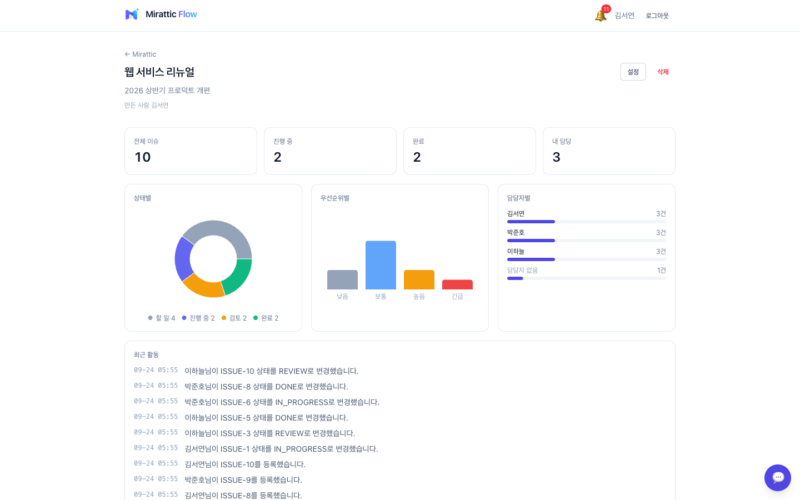
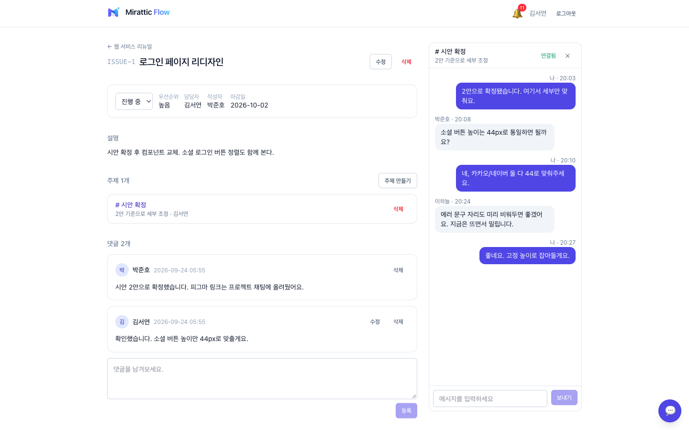
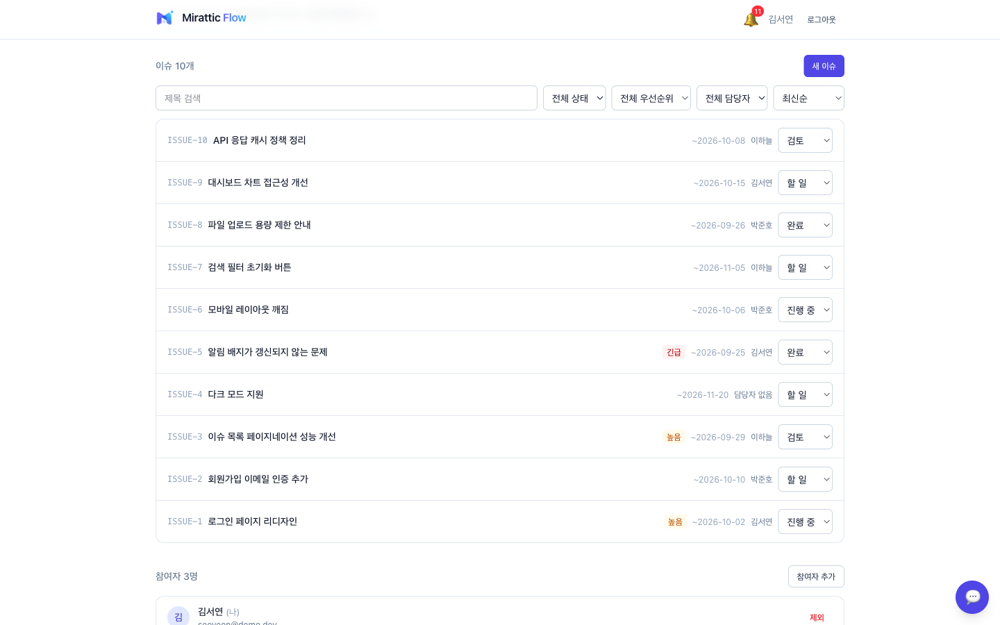
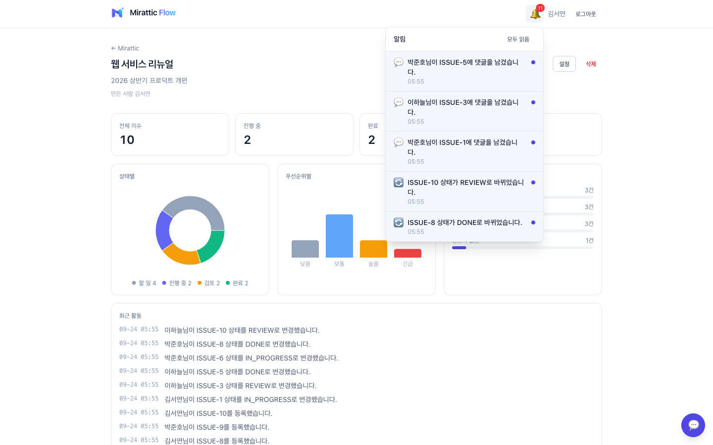
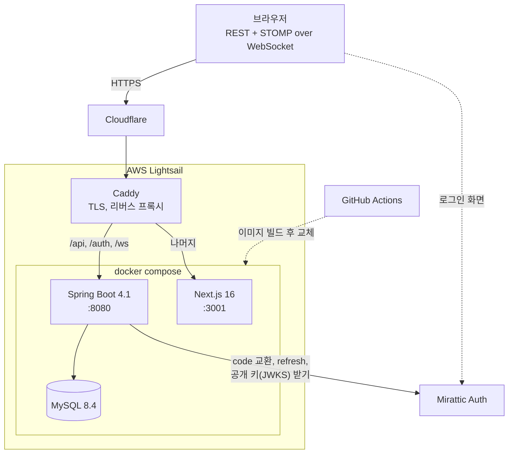

# Mirattic Flow

팀이 쓰는 협업, 이슈 관리 서비스입니다. 워크스페이스 안에서 프로젝트와 이슈를 관리하고, 실시간 채팅과 알림으로 이야기합니다.

[flow.mirattic.com](https://flow.mirattic.com)에서 돌아가고 있고, `main`에 푸시하면 자동으로 배포됩니다.

| | |
| --- | --- |
| 백엔드 | Java 21, Spring Boot 4.1, Spring Data JPA, Spring Security, WebSocket(STOMP) |
| 프런트엔드 | Next.js 16, React 19, TypeScript, Tailwind CSS 4, TanStack Query |
| DB | MySQL 8.4 |
| 인프라 | AWS Lightsail, Cloudflare, Docker Compose, Caddy, GitHub Actions |
| 규모 | 테이블 12개, REST 엔드포인트 54개, 백엔드 테스트 125개 |

## 화면

| 프로젝트 대시보드 | 이슈 상세와 분할 채팅 |
| --- | --- |
|  |  |

| 이슈 목록 | 알림 |
| --- | --- |
|  |  |

## 할 수 있는 것

로그인은 Mirattic 계정으로 합니다. Mirattic Sync와 같이 쓰는 계정이고, 지금은 카카오, 네이버, Google로 들어올 수 있습니다(이메일 로그인은 Auth에서 꺼 두었습니다).

워크스페이스를 만들고 초대 링크나 참여 코드로 팀원을 부릅니다. 역할은 OWNER와 MEMBER 두 가지입니다. 워크스페이스 안에 프로젝트를 만들고, 다 끝난 프로젝트는 보관해 둘 수 있습니다.

이슈에는 상태, 우선순위, 담당자, 마감일이 있고 검색, 필터, 정렬을 할 수 있습니다. 목록에서 상태를 바로 바꿀 수도 있습니다. 이슈마다 댓글을 달고, 프로젝트마다 오른쪽 아래 채팅방이 하나씩 있으며, 이슈 안에서 주제를 열면 화면을 나눠서 이야기할 수 있습니다.

담당자로 지정되거나 상태가 바뀌거나 댓글이 달리거나 프로젝트에 초대받으면 종 아이콘에 알림이 뜹니다. 대시보드에서는 상태별, 우선순위별, 담당자별 집계와 최근 활동을 봅니다.

## 구조



프런트와 API가 같은 도메인을 씁니다. 그래서 운영에서는 CORS 설정이 거의 필요 없고, `https://` 페이지에서 WebSocket 주소도 자연스럽게 `wss://`가 됩니다.

MySQL 포트는 밖으로 열지 않았습니다. 웹으로 열린 건 Caddy의 80, 443뿐이고 그것도 방화벽에서 Cloudflare를 거쳐 온 요청만 받습니다.

데이터 모델은 [ERD 문서](docs/erd.md)에 정리해 두었습니다.

## 고민했던 것들

### 로그인은 Mirattic Auth에 맡기고, 토큰은 HttpOnly 쿠키에만

처음에는 Flow가 가입, 로그인, 소셜 로그인, JWT 발급을 전부 직접 했습니다. 그러다 같은 사람이 쓰는 Mirattic Sync가 생기면서 계정을 한 곳(Mirattic Auth, OAuth 2.0 + OpenID Connect)으로 모았습니다.

Flow 백엔드는 client secret을 가진 클라이언트입니다. `/auth/start`에서 state와 PKCE 값을 만들어 Auth로 보내고, `/auth/callback`에서 code를 토큰으로 바꿉니다. secret은 서버에만 있습니다.
Flow가 토큰을 새로 만들지 않고 Auth의 access token을 그대로 씁니다. 그래서 Auth에서 계정을 막거나 비밀번호를 바꾸면 길어야 15분 안에 Flow에도 반영됩니다.

토큰은 HttpOnly 쿠키에만 둡니다(`flow_at` 15분, `flow_rt` 30일, refresh 쿠키는 `/api/auth` 경로에서만 전송). 예전처럼 localStorage에 두면 XSS 한 번에 토큰이 새어 나갑니다.
쿠키로 인증하면 CSRF를 신경 써야 해서, 상태를 바꾸는 요청에는 `X-Requested-With: flow` 헤더를 요구합니다. 다른 사이트의 폼은 이런 헤더를 붙일 수 없고, 다른 출처에서 fetch로 붙이려 하면 CORS 사전 요청에서 막힙니다.

기존 사용자는 숫자 id를 그대로 두고 `mirattic_uid` 컬럼 하나로 Auth 계정과 연결했습니다. 모든 테이블의 외래키를 UUID로 바꾸는 것보다 훨씬 덜 건드립니다.

### WebSocket 인증은 핸드셰이크 쿠키와 STOMP CONNECT로

브라우저의 WebSocket API는 핸드셰이크에 커스텀 헤더를 붙일 수 없습니다. 그렇다고 CONNECT 헤더에 토큰을 넣을 수도 없는 게, 토큰이 스크립트가 못 읽는 HttpOnly 쿠키에 있기 때문입니다.
대신 같은 출처의 핸드셰이크에는 쿠키가 자동으로 붙습니다. 그래서 핸드셰이크에서 쿠키 값을 세션 속성으로 옮겨 두고, STOMP CONNECT 프레임이 올 때 REST와 같은 JwtDecoder로 검증합니다. 쿼리스트링에 `?token=`을 붙이는 방법은 접근 로그에 토큰이 남아서 쓰지 않았습니다.

인증만 하고 끝내면, 로그인한 사람은 누구나 남의 프로젝트 주제를 구독할 수 있습니다. 그래서 같은 인터셉터에서 SUBSCRIBE와 SEND의 목적지도 확인합니다. 목적지는 클라이언트가 보내는 값이라 믿지 않습니다.

```java
case CONNECT   -> authenticate(accessor);
case SUBSCRIBE -> requireTopicAccess(accessor, "/topic/thread/");
case SEND      -> requireTopicAccess(accessor, "/app/thread/");
```

### 권한 검사는 서비스 입구 한 곳에서

워크스페이스, 프로젝트, 이슈 API의 컨트롤러에는 권한 검사 코드가 한 줄도 없습니다(운영자용 관리 API는 따로 검사합니다). 검사는 도메인을 따라 한 방향으로만 이어집니다.

```
WorkspaceService.requireMember / requireOwner
  └ ProjectService.requireAccess / requireManager
      └ IssueService.requireReadable
          └ TopicService.requireAccess, CommentService
```

이슈 API를 새로 만들 때 `requireAccess`를 한 번 부르면 프로젝트의 권한 규칙이 그대로 따라옵니다. 채팅을 붙일 때도 채팅용 권한 코드를 따로 쓰지 않았습니다.

"이 사람이 이걸 관리할 수 있나"(`canManage`)도 서버가 계산해서 응답에 넣어 줍니다. 프런트가 `createdByName === me.name` 같은 식으로 다시 판단하면 규칙이 두 군데 생기고, 한쪽만 고치는 순간 조용히 어긋나기 때문입니다.

### 실시간을 쓴 곳과 일부러 안 쓴 곳

WebSocket이 이미 있으니 알림도 푸시로 보낼 수 있었습니다. 그런데 채팅창을 접으면 STOMP 연결을 끊기로 정해 둔 상태였고, 알림 때문에 연결을 계속 붙잡고 있으면 그 결정이 의미가 없어집니다.

그래서 알림은 30초마다 폴링합니다. 그것도 안 읽은 개수 하나만 받고, 목록은 종을 눌렀을 때 받습니다. 배지에 필요한 건 숫자 하나인데 50건을 30초마다 실어 나를 이유가 없어서 `/unread-count`를 따로 만들었습니다.
알림은 몇 초 늦어도 괜찮은 정보라서, 초 단위로 오가는 채팅과는 다르게 다뤄도 된다고 판단했습니다.

### 알림 문장은 만들 때 완성해서 저장

`type`과 참조 id만 저장해 두고 읽을 때 문장을 조립하는 방법도 있습니다. 하지만 그러면 목록을 읽을 때마다 이슈와 댓글을 다시 조회해야 하고(N+1), 이슈 제목을 바꾸면 예전 알림 문장까지 같이 바뀌어 버립니다.

알림은 그때 일어난 일의 기록이라고 보고, 문장을 그 시점에 완성해서 넣었습니다. 덕분에 알림 목록 쿼리에는 조인이 하나도 없습니다.

### 세는 일은 DB에 맡기기

대시보드를 가장 쉽게 만드는 방법은 이슈를 전부 가져와서 자바에서 `groupingBy` 하는 겁니다. 30건일 때는 잘 됩니다. 하지만 3,000건이 되면 화면을 열 때마다 3,000건을 메모리로 끌어옵니다.

```java
@Query("""
        select new com.mirattic.flow.issue.dto.StatusCount(i.status, count(i))
        from Issue i where i.project.id = :projectId
        group by i.status""")
List<StatusCount> countByStatus(@Param("projectId") Long projectId);
```

`group by` 결과를 `Object[]`로 받아서 캐스팅하는 대신, JPQL 생성자 표현식으로 레코드에 바로 담았습니다. 타입이 유지되고 매핑 코드가 사라집니다.

상태, 우선순위, 담당자를 `group by` 하나로 묶지 않은 데도 이유가 있습니다. 묶으면 조합의 곱만큼 결과가 나오고, 0건인 조합은 아예 빠져서 결국 화면에서 다시 집계해야 합니다. 작은 `group by` 세 번이 더 싸고, 결과가 그대로 화면의 한 덩어리가 됩니다.
0건 채우기는 서버에서 합니다. "완료 0건"이 차트에서 사라지면 안 되니까요.

## 겪었던 문제들

### 폐기한 refresh token이 계속 통했다 (Auth로 옮기기 전, 직접 JWT를 만들던 때)

재발급을 연달아 두 번 호출했더니, 첫 번째에서 폐기됐어야 할 토큰으로 두 번째 재발급이 성공했습니다. rotation이 동작하지 않고 있었습니다.

DB를 열어 보니 행은 제대로 지워지고 있었습니다. 문제는 JWT 자체였습니다. payload에 `sub`, `email`, `iat`, `exp`만 있었는데 `iat`은 초 단위입니다. 같은 사용자가 같은 1초 안에 재발급을 받으면 payload가 완전히 같아지고, 새 토큰이 이전 토큰과 바이트 하나까지 똑같아집니다. "이전 토큰을 지우고 똑같은 값을 다시 넣는" 셈이었던 겁니다.

`jti`(UUID) 클레임을 넣어서 매번 다른 토큰이 나오게 했고, 다시 생기지 않도록 테스트 두 개를 남겼습니다.
시간 값만 믿고 고유하다고 기대하면 안 된다는 것, 그리고 "DB에서 지웠으니 폐기됐다"는 가정이 값이 같다는 이유만으로 깨질 수 있다는 걸 배웠습니다.

### 동시에 401을 받으면 로그아웃돼 버렸다

화면에 들어가면서 API를 여러 개 동시에 부르는데 access token이 만료돼 있으면, 전부 401을 받고 각자 재발급을 시도합니다. refresh token은 쓸 때마다 바뀌니까 첫 번째만 성공합니다.
나머지는 이미 폐기된 토큰으로 요청해서 실패하고, 실패 처리 코드가 토큰을 지우면서 로그아웃돼 버렸습니다. 재발급 정책과 클라이언트의 동시 요청이 부딪힌 경우입니다.

진행 중인 재발급 Promise 하나를 모듈 범위에서 같이 쓰도록 바꿨습니다.

```ts
refreshPromise ??= fetch('/api/auth/refresh', { method: 'POST', ... }).finally(() => { refreshPromise = null; });
```

이제 몇 개가 동시에 401을 받아도 재발급은 한 번만 일어납니다. 통계 API를 여러 개 동시에 부르는 대시보드에서 바로 터졌을 문제를 미리 막았습니다.

### WebSocket을 붙이자 앱이 뜨지 않았다

WebSocket 설정을 넣자 애플리케이션이 아예 시작되지 않았습니다. 에러는 `The dependencies of some of the beans form a cycle`.

```
StompAuthInterceptor → TopicService → ProjectService → SystemMessageSender
  → SimpMessagingTemplate → DelegatingWebSocketMessageBrokerConfiguration
  → WebSocketConfig → StompAuthInterceptor
```

WebSocket 메시징 쪽 빈은 애플리케이션 서비스보다 먼저 만들어져야 하는데, 그 인터셉터 안에서 서비스를 쓰려고 했던 게 원인이었습니다.

인터셉터가 `TopicService`를 `ObjectProvider<TopicService>`로 받게 했습니다. 프레임이 실제로 들어올 때는 모든 빈이 준비돼 있으니 그때 꺼내 씁니다. `@Lazy` 프록시 대신 이 방법을 고른 건, "지금이 아니라 나중에 꺼낸다"는 의도가 코드에 그대로 보여서입니다.

### 프로젝트를 지우면 500이 났다

`Referential integrity constraint violation: TOPICS FOREIGN KEY(PROJECT_ID)`.

연쇄 삭제를 서비스에서 순서대로 호출하고 있었는데도 터졌습니다. Spring Data의 파생 삭제(`deleteByProjectId`)는 엔티티를 읽어서 `em.remove`만 하고, 실제 DELETE는 커밋할 때 Hibernate가 정한 순서로 나갑니다. 부모가 자식보다 먼저 지워질 수도 있는 겁니다. 그동안 통과했던 건 순서가 우연히 맞아서였습니다.

연쇄 삭제 8곳을 모두 `@Modifying` JPQL 벌크 삭제로 바꿨습니다. 벌크 쿼리는 호출하는 즉시 SQL이 나가니까, 코드에 적힌 순서가 곧 실행 순서가 됩니다.

### 운영 스택이 개발 DB를 가져다 썼다

배포 구성을 로컬에서 시험해 보는데 백엔드가 `Access denied for user 'root'`를 내며 계속 재시작했습니다.

Compose는 프로젝트 이름을 디렉터리 이름으로 정합니다. 같은 폴더에 있던 `docker-compose.yml`(개발)과 `docker-compose.prod.yml`(운영)이 둘 다 `miratticflow` 프로젝트가 되면서 `miratticflow_mysql-data` 볼륨을 같이 쓰고 있었습니다. 운영 스택이 개발용 비밀번호로 초기화된 DB를 가져다 쓴 겁니다.

```yaml
name: mirattic-flow-prod
```

서버에는 스택이 하나뿐이라 그냥 지나갔을 수도 있습니다. 하지만 같은 머신에서 운영 구성을 시험하는 순간 개발 DB를 덮어쓰거나 운영이 옛 데이터로 뜰 수 있었습니다.

### WebSocket 확인이 400으로 나왔다

`curl`로 업그레이드를 시험했더니 400이 떴습니다. Caddy 문제인 줄 알았는데, curl이 HTTP/2로 붙어서였습니다. WebSocket 업그레이드는 HTTP/1.1에서만 됩니다. `--http1.1`을 붙이니 `101 Switching Protocols`가 나왔습니다.

브라우저는 WebSocket을 열 때 알아서 HTTP/1.1을 씁니다. 실제로는 아무 문제가 없었고, 시험 도구 때문에 멀쩡한 설정을 고칠 뻔했습니다.

## 로컬에서 돌리기

```bash
cp .env.example .env
docker compose up -d                    # MySQL 8.4

# Mirattic Auth를 local 프로파일로 먼저 띄워 둡니다 (Auth 저장소, http://127.0.0.1:9000)
cd backend && ./mvnw spring-boot:run    # http://127.0.0.1:8080

cd frontend && cp .env.local.example .env.local && npm install && npm run dev
# localhost가 아니라 http://127.0.0.1:3000 으로 여세요. Auth에 등록된 개발용 redirect가 127.0.0.1이고,
# 로그인 쿠키도 그 호스트에 붙습니다. /api, /auth 요청은 개발 서버가 백엔드로 넘깁니다.
```

```bash
cd backend && ./mvnw test     # 125개 (테스트에서는 Mirattic Auth 대신 JDK HTTP 서버로 만든 가짜를 씁니다)
cd frontend && npm run build  # 타입 체크도 같이 됩니다
```

소셜 로그인은 Mirattic Auth가 처리해서 Flow에는 소셜 로그인 키가 없습니다.

<details>
<summary>배포</summary>

`main`에 푸시하거나 GitHub Actions에서 `Deploy`를 직접 실행하면 배포됩니다.

먼저 CI 러너가 서버와 같은 아키텍처로 백엔드와 프런트 이미지를 만듭니다. 서버에서 빌드하지 않는 건, Next.js 빌드가 메모리를 1~2GB나 써서 4GB짜리 서버의 다른 서비스를 밀어낼 수 있기 때문입니다.
만든 이미지와 `docker-compose.prod.yml`, `deploy.sh`, `backup.sh`를 SSH로 올립니다. 서버 호스트 키는 Secrets에 넣어 둔 지문(`DEPLOY_HOST_FINGERPRINT`)으로 확인합니다. 이 값이 비어 있으면 확인을 건너뛰는데, Mac에서 돌리던 시절에만 비워 두었고 지금은 채워져 있습니다.
마지막으로 `deploy.sh`가 새 이미지로 바꾸고, 스택이 올라오지 않으면 이전 이미지로 되돌립니다. 최근 이미지 5개는 손으로 되돌릴 때를 위해 남겨 둡니다.

레지스트리는 쓰지 않습니다. 서버 접속 정보는 전부 GitHub Secrets에 있어서 공개 로그에 남지 않습니다.
`.env.prod`는 서버에만 두고 Git에 올리지 않습니다(`.env.prod.example` 참고). 운영 프로필의 `AUTH_CLIENT_SECRET`(Mirattic Auth의 `mirattic-flow` client secret)에는 기본값이 없어서, 변수가 아예 없으면 앱이 뜨지 않고 빈 값이면 로그인이 안 됩니다. 꼭 채워야 합니다.
DB는 매일 백업해서 7일치를 남깁니다. 백업 예약은 배포할 때마다 다시 등록하고, 등록에 실패하면 배포도 실패로 처리합니다.
5분마다 Flow, Sync, Auth, mirattic.com이 살아 있는지 확인하는 워크플로(`uptime.yml`)도 이 저장소에 있습니다. 하나라도 응답하지 않으면 워크플로가 실패하고 GitHub 알림 메일로 받습니다. 예약 실행이라 몇 분 늦을 때도 있습니다.

</details>

## AI 에이전트와 같이 만든 방식

Claude Code와 함께 만들었습니다. 코드를 뽑아내는 것보다, 어떤 방식으로 만들게 할지를 정하는 데 더 신경을 썼습니다.

먼저 규칙을 파일로 고정했습니다. [`CLAUDE.md`](CLAUDE.md)에 도메인별 패키지 구조, `open-in-view=false`, 엔티티를 컨트롤러 밖으로 내보내지 않기 같은 규칙을 적어 두면 매번 지적하지 않아도 됩니다. 여기서 더 중요했던 건 "하지 말 것" 목록이었습니다. 과도한 추상화, 구현이 하나뿐인 인터페이스, MSA나 Kubernetes 같은 것들입니다. 에이전트는 시키면 다 만들어 주기 때문에, 만들지 않을 것을 먼저 정해 두는 쪽이 효과가 컸습니다.

구현하기 전에는 설명부터 받았습니다. 단계마다 어떤 구조로, 어떤 파일을 만들고, 데이터가 어떻게 흐르는지를 먼저 듣고 확인한 뒤에 코드를 쓰게 했습니다. 느려 보이지만 설계 단계에서 되돌리는 게 코드가 쌓인 뒤에 되돌리는 것보다 훨씬 쌉니다. 무엇보다 면접에서 내가 설명하지 못하는 코드는 포트폴리오가 아니라고 생각했습니다. 위의 "고민했던 것들"은 그 확인 과정에서 정리된 내용입니다.

에이전트가 잘 모르는 최신 기술은 문서를 먼저 읽게 했습니다. Next.js 16은 에이전트가 알고 있는 Next.js와 많이 다릅니다. [`frontend/AGENTS.md`](frontend/AGENTS.md)에 추측하지 말고 `node_modules/next/dist/docs/`에 있는 설치된 버전의 문서부터 읽으라고 적어 두었는데, 이 한 줄이 잘못된 API 사용을 꽤 막아 줬습니다.

그리고 직접 돌려 보기 전까지는 끝난 게 아니라고 봤습니다. 위의 "겪었던 문제들"은 전부 코드가 그럴듯하게 작성된 다음, 테스트하고 실행하고 배포하면서 드러난 것들입니다. 폐기한 refresh token이 계속 통하던 버그도 테스트를 짜지 않았다면 그대로 배포됐을 겁니다.

단계별 구현 기록(설계, 결정 이유, 트러블슈팅, 검증, 한계)은 따로 남겨 두었고, 이 README의 내용은 그 기록에서 추린 것입니다. 처음 기획은 [기획안.txt](기획안.txt)에 있습니다.

## 다른 저장소

- [mirattic-main](https://github.com/G1Se0k/mirattic-main): 전체 구성과 mirattic.com
- [mirattic-auth](https://github.com/G1Se0k/mirattic-auth): 계정과 로그인을 맡는 인증 서버
- [mirattic-sync](https://github.com/G1Se0k/mirattic-sync): 같이 보기 확장과 서버
